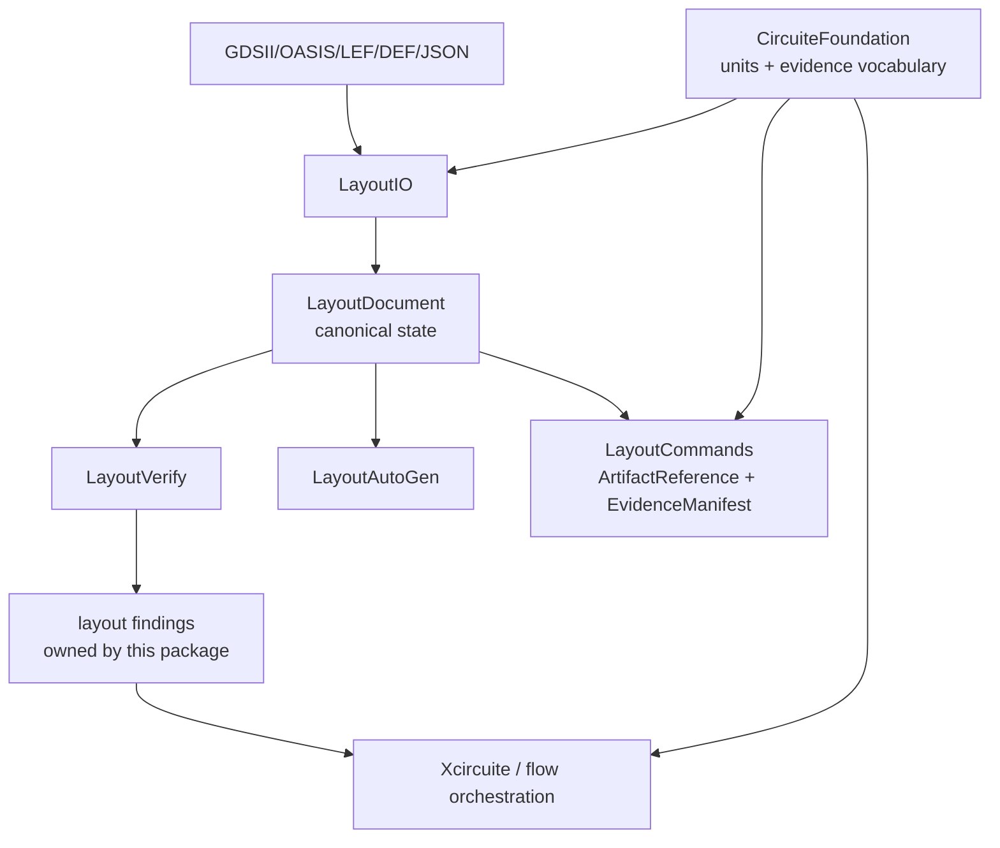

# semiconductor-layout design

## Purpose

This package is the physical-design library beneath a schematic/layout
application or a headless design agent. It models physical state and executes
layout algorithms. It does not own project manifests, run scheduling, approval
policy, or the cross-engine workflow.

## Layer responsibilities

| Layer | Owns | Does not own |
|---|---|---|
| `LayoutCore` | Canonical layout document and geometry | Artifact persistence and process execution |
| `LayoutTech` | Process layers, vias, rules, and rule-program metadata | Foundry rule interpretation outside its schema |
| `LayoutVerify` | DRC/connectivity/extraction calculations and typed findings | UI presentation or release policy |
| `LayoutIO` | Serialization and standard-format conversion | Canonical project directory layout |
| `LayoutLVSExtraction` | Layout extraction deck/IR preparation and audit | Netlist comparison policy owned by verification consumers |
| `LayoutAutoGen` | Placement/routing/generation algorithms | Tool trust or human approval |
| [LayoutEditor](Sources/LayoutEditor/DESIGN.md) | Interactive command application and live feedback | Persistence workflow |
| [LayoutCommands](Sources/LayoutCommands/DESIGN.md) | Replayable commands plus Foundation-native artifact references and evidence manifests | Long-running orchestration |

Production extraction rules cross the package boundary as versioned
`LayoutExtractionProcessProfile` artifacts. Consumers supply the profile and its
source deck together; `LayoutExtractionProcessProfileLoading` verifies schema,
semantic completeness, identity, and digest integrity. Process-specific Swift
factories are outside this package's responsibility.

`LayoutLVSExtraction` exposes source facts, not production eligibility.
`LayoutExtractionDeckUseScope` distinguishes fixture-only data from
process-provided data. `LayoutExtractionDeckAuditor` evaluates required device
families and returns `LayoutExtractionDeckSemanticReadiness`; `isReady` means the
requested extraction semantics are representable. Neither use scope nor
semantic readiness is a qualification decision. `ToolQualification` combines
these observations with independent tool, process, and policy evidence.
`LayoutExtractionProcessProfile.deckUseScope` is propagated into
`LayoutExtractionIR` so an independent consumer can evaluate the source scope
without this package making the decision itself.

## Shared foundation contract

`CircuiteFoundation` is a dependency floor, not an adapter layer:

1. `DatabaseUnitScale` is the validated cross-package unit boundary.
2. `Engine` is available to domain engines that expose request/output
   execution; this package does not wrap every service in a universal envelope.
3. Artifact and diagnostic types are used at package boundaries when an
   artifact or finding crosses into an orchestration package.
4. Layout-specific types remain strongly typed and are not replaced by generic
   Foundation values.

`LayoutCommands` depends on `CircuiteFoundation` directly. Its public result
types carry `ArtifactReference` values instead of parallel path, digest, and
byte-count fields. The CLI persists `EvidenceManifest` with
`ExecutionProvenance`; `ArtifactReferencing` is the protocol boundary and
`LocalArtifactReferencer` is the default implementation. No layout-specific
artifact facade or compatibility schema exists. `LayoutCommandRunning` is the
execution boundary; `LayoutCommandRunner` conforms directly.

LayoutIO DEF export propagates the standard converter's representability failure
through its existing `LayoutIOError.conversionFailed` boundary before writing any
output bytes. Arbitrary angles and non-unit magnification cannot be silently
mapped to a legal DEF orientation; supported quarter-turn/mirror transforms use
the common standard mapping.

## Determinism and signoff boundary

Imported identities are derived from stable source identity and element order.
Verification traverses reachable hierarchy with cycle/missing-reference checks.
`LayoutDRCService` distinguishes development geometry from exact-only
verification; exact-only mode must fail closed when its kernel cannot represent
the source geometry.

## Extension point for implementation agents

Agents extending this package should add domain types in the owning target,
preserve `LayoutDocument` as the canonical state, expose typed errors and
structured diagnostics, and add a focused Swift Testing suite. A new engine
should depend on `CircuiteFoundation` directly when it implements the shared
`Engine` protocol; it should not add a package-level adapter or project model.

## Hierarchical via geometry composition

The canonical placement contract is owned by [LayoutCore](Sources/LayoutCore/DESIGN.md)
and [ViaGeometry](Sources/LayoutCore/ViaGeometry/DESIGN.md). The standard affine boundary is owned by [LayoutIO](Sources/LayoutIO/DESIGN.md).
The shared footprint
and contact contract is owned by [LayoutVerify](Sources/LayoutVerify/DESIGN.md).
Command/editor materialization, antenna checks and deck-driven LVS consume those
value operations; local geometry semantics must not be inferred from the anchor.

| Consumer | Required composition | Behavioral test owner |
|---|---|---|
| DRC and batch/live connectivity | Use transformed world footprints and exact-mode admission | `LayoutAutoGenTests/HierarchicalViaGeometryTests` |
| CLI flatten | Persist via geometry and pin extents with fresh IDs | `LayoutCommandsTests/LayoutHierarchyCommandTests` |
| Editor flatten | Same value operations, fresh IDs | `LayoutEditorTests/LayoutFlattenGeometryTests` |
| LVS extraction | Transformed explicit cuts, blocking unrepresentable geometry | `LayoutLVSExtractionTests/LayoutGeometryExtractorTests` |
| Canonical persistence | Complete pose round trip and trust-boundary validation | `LayoutCoreTests/LayoutViaGeometryTests` |
| Standard export | Reject unrepresented local poses before producing output | `LayoutIOTests/IRLayoutConverterViaTests` |

The marked LayoutIO standard via bridge still needs complete layer/pose round
trips before its unsupported-pose rejection can be removed. Native exact
extraction must consume the later bounded snapshot contract before claiming RC
completion. Native macOS evidence does not qualify WASM or Embedded execution.

The bounded source/world hierarchy contract is owned by
[HierarchyCapture](Sources/LayoutVerify/HierarchyCapture/DESIGN.md). It is the
shared traversal for DRC, batch/live connectivity, routing and device extraction;
native contact topology and electrical qualification remain separate contracts.

Native occurrence-exact contact facts are owned by
[ConductorCapture](Sources/LayoutVerify/ConductorCapture/DESIGN.md). Legacy
aggregate-via identities require migration before their electrical results can
inherit this topology guarantee.

Source-bound DEF root terminal preservation in standard mask output is owned by
[LayoutIO](Sources/LayoutIO/DESIGN.md). The caller supplies actual pin metal and
canonical net incidence; the adapter guarantees exact paired geometry/text
admission. Host composition and actual TOP LVS proof remain upper-layer owners.
