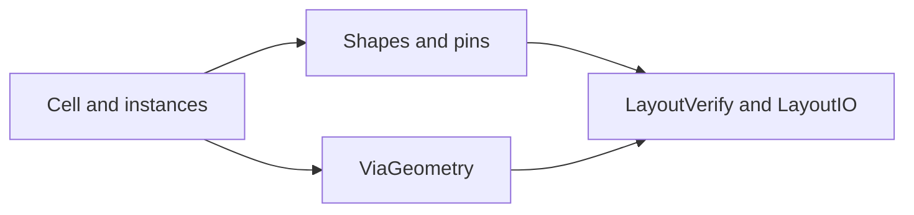

# LayoutCore

## Purpose and Scope
Canonical value-owned layout cells, geometry, nets, pins and instances. Parent:
[package](../../DESIGN.md). Current change child: [ViaGeometry](ViaGeometry/DESIGN.md).

## Responsibilities and Boundaries
Own physical state and affine geometry semantics. Technology rules, electrical
models, verification and persistence operations are outside this module.

## Related Designs
| Design | Relationship | Contract Used | Summary | Cautions |
|---|---|---|---|---|
| [Package](../../DESIGN.md) | parent | Canonical physical state | Package composition | Preserve standard-format semantics |
| [ViaGeometry](ViaGeometry/DESIGN.md) | child | Ordered local geometry placement | Hierarchical via footprints | Transform order is part of identity |
| [LayoutVerify](../LayoutVerify/DESIGN.md) | used by | Geometry and hierarchy values | Physical contact consumers | Definition and pose must travel together |

## Architecture

## Contracts and Invariants
Physical state is represented by `Sendable` value types. Instance transforms
apply to physical extents as well as placement centers. Serialization preserves
all represented geometry and transform fields. Exact quarter-turn rotations use
coordinate permutations so rectilinear edges remain rectilinear without tolerance
widening. Pin transforms return world extents; arbitrary-angle extents are
axis-aligned envelopes, not exact pin polygons.

## Verification and Change Impact
[LayoutCoreTests](../../Tests/LayoutCoreTests) owns value and serialization
contracts; [LayoutAutoGenTests](../../Tests/LayoutAutoGenTests) owns the shared
contact-path behavioral evidence. Geometry schema changes affect LayoutIO,
LayoutTech and LayoutVerify consumers.
