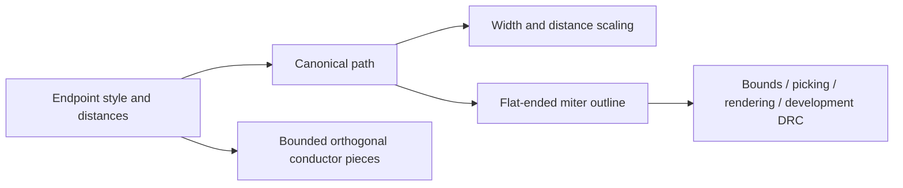

# PathGeometry

## Purpose and Scope
Own canonical path values and flat-ended miter geometry. Parent:
[LayoutCore](../DESIGN.md). Children: none.

## Responsibilities and Boundaries
Endpoint style owns its distances: flush, half-width, circular, or explicit
signed begin/end extensions in micrometers. Positive values extend outwards;
negative values retract. IO owns database-unit conversion; verification owns
grid admission, union, resource budgets and qualification.

## Related Designs
| Design | Relationship | Contract Used | Summary | Cautions |
|---|---|---|---|---|
| [LayoutCore](../DESIGN.md) | parent | Value-owned geometry | Canonical path state | No compatibility schema required |
| [LayoutIO](../../LayoutIO/DESIGN.md) | used by | Explicit distances | Standard round trips | Both custom distances must exist |
| [ConductorCapture](../../LayoutVerify/ConductorCapture/DESIGN.md) | used by | Endpoint distances | Bounded orthogonal union | Circular caps remain unsupported |

## Architecture

## Contracts and Invariants
Explicit distances are finite and scale by absolute uniform magnification.
Translation, rotation, reflection and handle edits retain their endpoint order.
Custom-path splitting preserves the two original outer distances and gives each
new interior endpoint zero extension. Existing symmetric-cap split behavior is
outside this custom-extension change. Flat-ended outlines use offset-line
intersections at joins, never normalized averaged normals. Zero-length segments,
immediate reversals, nonfinite results, and retractions crossing the adjacent
segment are typed failures. Numeric convenience queries expose invalid flat
paths as NaN; input owners validate source paths before publishing results. Circular paths remain represented as circular, not
silently flattened. The polygon operation explicitly rejects circular caps.

Straight orthogonal paths use an equivalent rectangle without allocating an
outline. Rectangle-to-rectangle distance uses interval separation; this preserves
extended/retracted caps and returns zero for containment. General outline queries
remain development geometry; electrical area/contact semantics come from the
bounded union capture, not shoelace sums over overlapping outlines.

## State, Ownership, and Lifecycle
Values and geometry work are synchronous and call-local. Outline storage is
linear in point count and is used at hierarchy bounds and presentation/development boundaries;
bounded electrical capture streams union pieces without materializing it.

## Failure, Concurrency, and Constraints
`LayoutPathGeometryError` identifies invalid values, degenerate segments,
unsupported circular outlines, reversals and invalid retractions. Development
DRC rejects unsupported paths before running rules. Exact DRC retains its
existing all-path rejection until its integer-grid/union admission is migrated.

## Verification and Change Impact
`LayoutCoreTests/LayoutPathGeometryTests` owns transforms, serialization, signed
caps, miter geometry and failures. `LayoutIOTests/PathExtensionRoundTripTests`
owns standard bytes and conversion failure. `LayoutAutoGenTests` owns actual
contact and DRC admission. Path schema changes require updating IO, hierarchy,
commands, editor and extraction ordering together.
