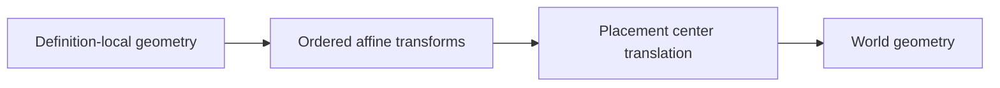

# ViaGeometry

## Purpose and Scope
Own definition-local via geometry placement. Parent: [LayoutCore](../DESIGN.md).
Children: none.

## Responsibilities and Boundaries
Preserve the definition ID, center, ordered local geometry transforms and net
annotation and generic source properties as a `Sendable` value. Process definitions and connectivity policy
are owned by LayoutTech and LayoutVerify.

## Related Designs
| Design | Relationship | Contract Used | Summary | Cautions |
|---|---|---|---|---|
| [LayoutCore](../DESIGN.md) | parent | Geometry and affine values | Canonical physical state | Update serialization evidence when fields change |
| [LayoutVerify](../../LayoutVerify/DESIGN.md) | used by | Definition-local geometry transformation | Shared DRC and connectivity footprints | Axis-aligned bounds do not prove arbitrary-angle exactness |

## Architecture

## Contracts and Invariants
- Transform arrays use outermost-first order and execute in reverse.
- Local geometry is transformed before adding the placement center.
- Hierarchy translations affect the center; hierarchy linear transforms affect
  the local geometry, including any existing local affine offsets.
- Identity parent linear transforms are omitted; pure translations change only the center.
- Definition and source IDs and all generic properties are preserved across occurrences.
- Properties are value-owned semantic annotations, as on LayoutShape; adapters own
  source-format validation and serialization policy, not geometry consumers.
- JSON requires the properties field; missing canonical state is a decoding failure.
- Encoded via values retain the complete transform array; missing schema fields
  are not silently replaced during decoding.

## State, Ownership, and Lifecycle
All properties and transform arrays are value-owned canonical state. Reads
perform pure transformations and retain no pointer, callback or shared cache.

## Verification and Change Impact
[LayoutCoreTests](../../../Tests/LayoutCoreTests) verifies serialized transform
round trips. [HierarchicalViaGeometryTests](../../../Tests/LayoutAutoGenTests/HierarchicalViaGeometryTests.swift)
executes actual shared flattening and contact predicates. LayoutVerify footprint
consumers and standard interchange must reevaluate new placement semantics.
