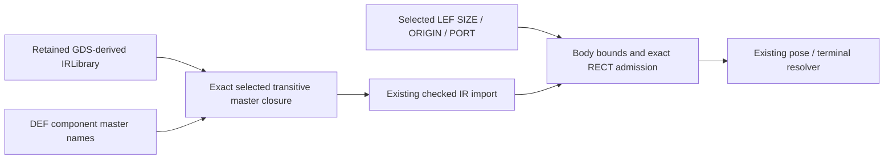

# DEF Master Composition

## Purpose and Scope
Own retained full-mask master composition for DEF import. Parent: [LayoutIO](../DESIGN.md).
Children: none.

## Responsibilities and Boundaries
The caller digest-locks the baseline GDS and supplies its decoded immutable `IRLibrary` together
with the selected LEF. This component resolves exact DEF master names and their transitive mask
closure before canonical conversion. It neither retrieves assets nor generates device geometry.
The existing DEF resolver owns terminal incidence and SIZE-normalized placement.

## Related Designs
| Design | Relationship | Contract Used | Summary | Cautions |
|---|---|---|---|---|
| [LayoutIO](../DESIGN.md) | parent | Public standard converter | Composes admitted source views | Mask presence never falls back to abstract ports |
| [LayoutCore](../../LayoutCore/DESIGN.md) | depends on | Geometry bounds and affine transforms | Bounds validation without flattening | Preserve hierarchy and source geometry |

## Architecture

## Contracts and Invariants
`MaskDataFormatConverter(tech:standardCellLibrary:standardCellLibraryMask:)` retains value-owned
source views. A nil mask selects the existing abstract LEF port lane. A supplied mask requires
identical positive DEF, technology, mask and LEF DBU scales; unique exact selected master names;
unique resolvable transitive references; no cycles or collision with the DEF top. Only selected
closure cells are composed, replacing empty DEF placeholders rather than appending duplicates.
Every mask geometry/text layer pair must map uniquely to an explicit technology layer.

LEF masters retain the existing positive SIZE, zero ORIGIN and single unmasked RECT PORT
profile. Full bodies must contain physical shapes, have finite bounds within `[0, SIZE]`, and
have each port represented by exactly one top-level source rectangle on its declared layer.
Rectangular polygons are admitted by exact source-DBU four-corner equality and axis-aligned perimeter; distributed, hierarchical-only,
nonexact or ambiguous port coverage is typed unsupported. No envelope substitutes for metal.
An already net-bound shape cannot be overwritten or aliased by another terminal.
Source text requires the identity local transform because LayoutLabel has no text-pose field.
The existing source shape receives the canonical local pin net; no synthetic port metal is added.
Source labels and hierarchy remain represented, and all eight DEF poses use the existing resolver.

Body bounds compose existing public geometry bounding boxes and affine transforms, bottom-up.
Array extrema suffice for conservative bounds without materializing occurrences. This validation
never flattens, unions, or rewrites source geometry. Arbitrary internal reference rotations may
have conservative bounds; any rejected nonexact fit remains explicitly unsupported.

## State, Ownership, and Lifecycle
All source, graph and canonical state is invocation-local value state. The converter owns immutable
COW views for its lifetime; no mutable cache, I/O or shared synchronization is introduced.

## Failure, Concurrency, and Constraints
`LayoutIOError.incompatibleStandardCellMask` rejects missing, duplicate, cyclic, unmapped or
incompatible full-mask sources before publishing a document. Valid unrepresented mask features use `unsupportedStandardCellMask`. Unsupported PORT coverage uses
`unsupportedSourcePin` with an incomplete implementation marker. Iterative closure traversal
is bounded by supplied cells/references; bounds use one cached result per selected closure cell.
DEF export of a full-body master remains explicitly unsupported by the existing abstract-master
export admission. Standard GDS/OASIS geometry export uses the existing canonical serializer.
Root DEF terminal preservation is owned by the parent
[LayoutIO source-bound terminal contract](../DESIGN.md#source-bound-def-terminals-in-standard-mask-output);
retained child master labels are not promoted into root terminals.

## Verification and Change Impact
[DEFMasterCompositionTests](../../../Tests/LayoutIOTests/DEFMasterCompositionTests.swift) uses
actual GDS bytes decoded to IR, DEF imports, canonical body/labels/hierarchy and native capture
for eight independent pose matrices. Negative inputs prove units, missing/duplicate/cyclic names,
layer, SIZE/ORIGIN and exact PORT failure without partial publication. Existing LEF-only tests
retain abstract lane behavior. Native LVS matching belongs to upper composition fixtures and
adds no reverse dependency from LayoutIO to LVSEngine.
