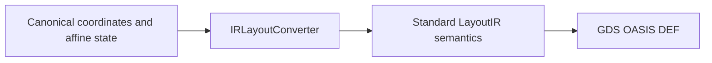

# LayoutIO

## Purpose and Scope
Standard format adapters and canonical JSON persistence. Parent: [package](../../DESIGN.md).
Children: none introduced for this change.

## Responsibilities and Boundaries
Own coordinate and transform translation between canonical LayoutCore values
and standard LayoutIR values. Geometry algorithms and process via definitions
are owned by LayoutCore and LayoutTech.

## Related Designs
| Design | Relationship | Contract Used | Summary | Cautions |
|---|---|---|---|---|
| [Package](../../DESIGN.md) | parent | Standard-format composition | Developer and command IO | Preserve physical meaning across formats |
| [OASIS](../../../swift-mask-data/Sources/OASIS/DESIGN.md) | depends on | Standard signed PATH bytes and cell modality | Independent codec evidence | Exact pinned codec revision is required |
| [LayoutCore](../LayoutCore/DESIGN.md) | depends on | Coordinate-negation mirror flags | Canonical affine state | The mirror flag name alone does not establish axis semantics |
| [ViaGeometry](../LayoutCore/ViaGeometry/DESIGN.md) | depends on | Full local via placement | Persist all represented state | Standard via bridge remains explicitly incomplete |

## Architecture

## Contracts and Invariants
Standard custom paths require both signed begin/end extension fields. They map
to canonical explicit micrometer distances and export as custom path records;
missing fields, nonfinite values and off-grid/overflow export fail before output.
Other path styles cannot carry ignored custom fields. OASIS import/export uses the verified codec revision with resolved endpoint distances and standard DBU per micrometer; omitted fields never reset extensions or borrow text/placement origins.

LayoutCore `mirrorX` negates the X coordinate; `mirrorY` negates Y.
LayoutIR `mirrorX` reflects about the X axis, negating Y before rotation.
Import maps that flag to canonical `mirrorY`. Export uses the XOR of canonical
mirror flags as the IR flag and adds 180 degrees to the angle when canonical
`mirrorX` is set. Both mirrors are therefore preserved, including array references.
Equivalent affine actions, rather than identical flag encodings, define preservation.

Canonical JSON persists full local via transforms. Standard via export rejects
local poses that the bridge cannot round-trip; its incomplete implementation
marker remains until every layer footprint and pose is preserved.

## Failure, Concurrency, and Constraints
Unsupported representation is a typed `LayoutIOError` before output creation.
These mappings operate on value-owned state with no shared mutable cache.

## Verification and Change Impact
`IRLayoutConverterTransformTests` compares actual imported/exported point mappings
for mirror combinations, quarter and arbitrary angles, single and array references.
`DocumentRoundTripTests` and command format tests execute DEF placement export
and import. Via rejection and canonical transform serialization have separate
behavioral tests. `PathExtensionRoundTripTests` additionally reads independent standard OASIS bytes, exports/reimports them and checks exact conductor bands through LayoutVerify. Geometry changes require reevaluating verification and LVS consumers.
