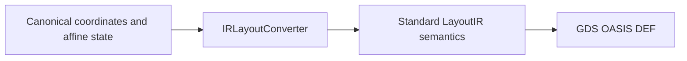
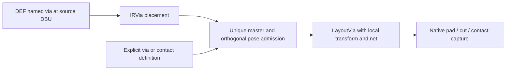
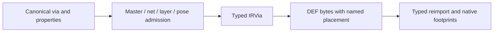
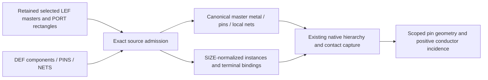

# LayoutIO

## Purpose and Scope
Standard format adapters and canonical JSON persistence. Parent: [package](../../DESIGN.md).
Children: [DEFMasterComposition](DEFMasterComposition/DESIGN.md).

## Responsibilities and Boundaries
Own coordinate and transform translation between canonical LayoutCore values
and standard LayoutIR values. Geometry algorithms and process via definitions
are owned by LayoutCore and LayoutTech.

## Related Designs
| Design | Relationship | Contract Used | Summary | Cautions |
|---|---|---|---|---|
| [Package](../../DESIGN.md) | parent | Standard-format composition | Developer and command IO | Preserve physical meaning across formats |
| [OASIS](../../../swift-mask-data/Sources/OASIS/DESIGN.md) | depends on | Standard signed PATH bytes and cell modality | Independent codec evidence | Exact pinned codec revision is required |
| [ViaPlacement](../../../swift-mask-data/Sources/LayoutIR/ViaPlacement/DESIGN.md) | depends on | Typed named via placement | DEF source semantics without fabricated paths | Verified immutable dependency must provide `IRElement.via` |
| [LayoutCore](../LayoutCore/DESIGN.md) | depends on | Coordinate-negation mirror flags | Canonical affine state | The mirror flag name alone does not establish axis semantics |
| [ViaGeometry](../LayoutCore/ViaGeometry/DESIGN.md) | depends on | Full local via placement | Persist all represented state | Standard via bridge remains explicitly incomplete |

## Architecture

## Contracts and Invariants
Standard custom paths require both signed begin/end extension fields. They map
to canonical explicit micrometer distances and export as custom path records;
missing fields, nonfinite values and off-grid/overflow export fail before output.
Other path styles cannot carry ignored custom fields. OASIS import/export uses the verified codec revision with resolved endpoint distances and standard DBU per micrometer; omitted fields never reset extensions or borrow text/placement origins.

LayoutCore `mirrorX` negates the X coordinate; `mirrorY` negates Y.
LayoutIR `mirrorX` reflects about the X axis, negating Y before rotation.
Import maps that flag to canonical `mirrorY`. Export uses the XOR of canonical
mirror flags as the IR flag and adds 180 degrees to the angle when canonical
`mirrorX` is set. Both mirrors are therefore preserved, including array references.
Equivalent affine actions, rather than identical flag encodings, define preservation.

Canonical JSON persists full local via transforms. GDS/OASIS via export rejects
local poses that those bridges cannot round-trip; its incomplete implementation
marker remains until every layer footprint and pose is preserved.

### Typed DEF via placement import

`IRElement.via` is a placement, independently of wire paths. LayoutIR owns its
source-DBU origin, exact master name, declared route layer, transform and source
route properties. LayoutIO resolves the master to exactly one explicit technology
via or contact definition before publishing a document. Missing or duplicate
masters, unresolved or conflicting route layers, ambiguous route fields, blank declared nets and
nonfinite/nonorthogonal/non-unit transforms fail with `LayoutIOError`.
DEF orientation reflects about the X axis before counterclockwise rotation;
the adapter maps this to canonical `mirrorY` in definition-local
`LayoutVia.geometryTransforms`. Source library units, master name and net binding
remain exact. Generic via properties retain source route intent in canonical state. Import emits one `LayoutVia` and no `LayoutShape` for each typed
placement; pad and cut geometry comes exclusively from the technology definition.
Route-layer ID/display aliases use the same case-insensitive comparison as DEF's
explicit layer-number mapping; the physical GDS number and master landing layer
must still match. Alias comparison never rewrites the source route annotation.

| Input | Adapter guarantee | Behavioral evidence |
|---|---|---|
| Standalone named via | No synthetic wire or duplicate placement | Four actual native DEF placement coordinates |
| Source units and net | Exact DBU-to-micrometer conversion and net identity | Imported units, positions and declared net |
| DEF orientation | Local transform applied before placement | Eight orthogonal poses and asymmetric footprints |
| Explicit technology | Master-selected pads, cuts and contacts | Native conductor capture with no shape sources |
| Invalid placement | Typed failure before document publication | Missing/duplicate master and invalid pose/layer cases |

### Named DEF via export

The existing `includeDEFRouteMetadata` boundary emits typed IRVia placements for
DEF, independently of wire geometry. Every placement must bind one explicit via
or contact master and a declared canonical net. Imported route kind, status,
layer alias, special width and shape are retained in generic LayoutVia properties;
partial or conflicting source intent fails rather than becoming a normal route.
The declared layer must resolve uniquely to a master landing layer and its physical
number. A native placement without source route properties serializes as a normal
ROUTED placement on the explicit master's bottom landing layer; this is an export
policy, not a recovered source fact. No net or master is inferred from geometry.

Finite orthogonal unit local transforms with zero local translation compose in
outermost-first order into one DEF orientation. Nonorthogonal, scaled or translated
local poses, non-top cell vias and missing/ambiguous bindings fail before the
atomic file write. Caller technology or retained explicit DEF VIAS records supply
masters; exporting a placement does not fabricate a master definition.

DEF inverse conversion normalizes a separated placement to an explicit coordinate.
Wildcard coordinate spelling is not identity: resolved coordinates, source route
intent, master, net, units and native pad/cut/contact geometry are the invariants.
The other standard export branches and their incomplete implementation markers
remain unchanged.

## Failure, Concurrency, and Constraints
Unsupported representation is a typed `LayoutIOError` before output creation.
These mappings operate on value-owned state with no shared mutable cache.

## Verification and Change Impact
`IRLayoutConverterTransformTests` compares actual imported/exported point mappings
for mirror combinations, quarter and arbitrary angles, single and array references.
`DocumentRoundTripTests` and command format tests execute DEF placement export
and import. Via rejection and canonical transform serialization have separate
behavioral tests. `PathExtensionRoundTripTests` additionally reads independent standard OASIS bytes, exports/reimports them and checks exact conductor bands through LayoutVerify. Geometry changes require reevaluating verification and LVS consumers.

[TypedViaPlacementIntegrationTests](../../Tests/LayoutIOTests/TypedViaPlacementIntegrationTests.swift)
imports the four actual native DEF named-only coordinates through the public byte
adapter, checks all eight orientation matrices against asymmetric native pad/cut
bands and contact topology, and rejects invalid placement before publication.
Normal and special routes retain their wire paths and produce exactly one via.

`TypedViaExportTests` owns public DEF write/read, all eight asymmetric native
footprints, source normal/special intent, native serialization policy and atomic
failed-export preservation. `LayoutViaGeometryTests` owns generic property
transform and JSON retention.

### Bound DEF component and terminal admission

`MaskDataFormatConverter(tech:standardCellLibrary:)` consumes a caller-retained
LEFDocument. The explicit `importFromData(_:format:)` boundary decodes those exact
captured DEF bytes; file import reads once and delegates. Raw mask interchange can
represent black boxes, but canonical DEF import requires all component masters and
net terminal references to bind actual source definitions before publishing.

The admitted profile is a uniquely named LEF master with positive explicit SIZE,
zero ORIGIN, and each connected pin represented by one single-layer RECT PORT.
Finite ordered coordinates must be exact on both source LEF and DEF grids; the
centered canonical pin must be representable on the native capture grid. Multi-RECT,
multilayer, polygon, via or missing port geometry and nonzero ORIGIN are typed
unsupported, with incomplete implementation markers at the rejected branches.
Directions retain actual source meanings. Admitted pin uses SIGNAL/POWER/GROUND
map to canonical roles; unsupported CLOCK/ANALOG use is rejected, not coerced.

Each admitted port produces its actual metal rectangle as a LayoutShape and a
LayoutPin with the same unique local net. Master SIZE is metadata only:
`lef.macro.widthMicrometers` and `lef.macro.heightMicrometers`, finite positive
micrometer decimal values. It is never emitted as a conductor. Component poses
normalize all eight standard orientations against the transformed declared SIZE
bounds; canonical instance names/IDs and terminalNetIDs retain source incidence.

Top DEF PINS require actual layer rectangles, placement, direction and net authority;
labels cannot substitute for them. Net connections must resolve declared top pins
or exact component/master pin names. Conflicting bindings fail atomically.
Wildcard component connections resolve only existing declared source ports; a
wildcard without any resolved source terminal fails. Unconnected pins do not
invent root nets. Imported top pins emit their real metal rectangle and canonical
terminal. Export emits real standard PINS from canonical rectangle/direction/net
facts, or rejects missing/unrepresentable state before the atomic write.

Public capture pinGeometries and Pin.footprintIndices own the actual surface contact
proof. A host may choose a unique existing route terminal endpoint only when exact
net and instance:pin identity, transformed source rectangle and positive contact
incidence agree. Pin centers, nearest geometry and macro outlines are not access
node authority. Host artifact byte identity and endpoint selection are outside
LayoutIO ownership.

`DEFBoundPinTests` verifies the actual selected native source master and route
endpoints, all eight SIZE-normalized poses, top PINS, exact JSON direction,
source-derived contact incidence and rejected incomplete/ambiguous bindings.
Existing route/via fixtures migrate dangling terminal references to real declared
PINS while retaining route geometry assertions.

Top PIN source metal carries `def.pin.name`, `def.pin.status`, `def.pin.special`, and
JSON `def.pin.properties` annotations. These retain source placement status and nongeometry
properties through native persistence and DEF export. Canonical net bindings own emitted
connections; source net class and routing intent remain preserved. A changed master port that
no longer matches the selected LEF cannot be exported as that external master.

The DEF geometry projection sends ROUTES and named vias through existing LayoutIR conversion.
PINS are handled once by the source resolver, rather than raw layer-zero text. DIEAREA is a
placement domain, not a conductor: exact typed source points are retained as JSON `def.dieArea`
cell metadata and restored by DEF export. No die boundary or macro SIZE is stamped as metal.
Standard imports mint document-local net IDs; preservation compares resolved declared net names
and instance:pin incidence, not UUID identity across independently imported documents.

Top PINS transforms apply the eight standard discrete matrices to source DBU rectangle corners
before placement addition. Integer overflow and centered-grid admission precede native values;
no floating cancellation or widened epsilon changes an admitted source port.

### Retained full-mask DEF masters

The optional `standardCellLibraryMask: IRLibrary` source selects the
[DEFMasterComposition](DEFMasterComposition/DESIGN.md) contract. That component owns exact
source-view closure and full-body admission; the existing resolver owns pose and terminal binding.
