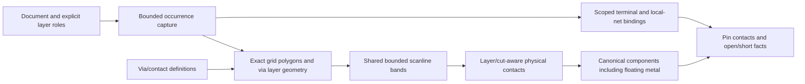

# ConductorCapture

## Purpose and Scope
Own bounded native rectilinear layer/cut contact facts. Parent:
[LayoutVerify](../DESIGN.md). RC models, process qualification and legacy UI
flyline/live-session representations remain separate responsibilities.

## Responsibilities and Boundaries
Capture every occurrence through HierarchyCapture, admit exact grid geometry,
retain all selected floating metal and each via layer/cut footprint, construct
physical contacts and report scoped declared-net and terminal facts. The caller
supplies conductive layer roles; display metadata does not define conductivity.
Pins retain the actual contacted footprint indices as source facts, label contacted components and never conduct or join disconnected islands. Component membership alone is insufficient to reconstruct pin incidence after a split.

## Related Designs
| Design | Relationship | Contract Used | Summary | Cautions |
|---|---|---|---|---|
| [LayoutVerify](../DESIGN.md) | parent | Native contact entry point | Electrical consumers use captured facts | Legacy aggregate-via analysis remains unqualified |
| [HierarchyCapture](../HierarchyCapture/DESIGN.md) | depends on | Occurrence paths and owned geometry | One traversal | Source IDs alone do not identify occurrences |
| [ViaGeometry](../../LayoutCore/ViaGeometry/DESIGN.md) | depends on | Definition-local transforms | Exact placed footprint | No bounding-box geometry substitution |
| [RectilinearDecomposition](../../../../swift-mask-data/Sources/MaskGeometry/RectilinearDecomposition/DESIGN.md) | depends on | Exact bounded bands | Concave and holed coverage | Existing exact-kernel capability is rectilinear |

## Architecture

## Contracts and Invariants
`captureConductors` returns owned integer geometry and occurrence-exact source
references. Selected conductor layers must be declared technology layers and
must not be cut layers. A cut layer has one unambiguous bottom/top adjacency
from the technology via/contact definitions; distinct cuts are never connected
by definition identity or by a declared net label. Vias retain individual cut
rectangles and every declared metal footprint. Incomplete explicit geometry,
unknown definitions and extra layers without topology fail. A definition with
no explicit geometry uses its declared cut size and top/bottom enclosure to
construct its three-layer template; this is defined geometry, not a fallback.

Source/world coordinates must be finite and representable on the document's
integer database grid within four floating-point ulps of multiplication error.
Int32 conversion is checked. Rectangles and rectilinear even-odd polygons use
the exact MaskGeometry kernel; empty conducting coverage and non-Manhattan
geometry fail explicitly under the current exact-kernel capability.

Admitted canonical paths use orthogonal, nonzero centerline segments and square
miter joins. A stroke is the union of segment rectangles and right-angle join
squares; flush caps stop at the spine endpoint and extended caps add half the
width; explicit caps use their separate signed endpoint distances. Retraction
that crosses an adjacent segment fails; a retracted endpoint entering an
adjacent miter square is unsupported until clipping can preserve its cap plane. Circular caps, diagonals and immediate reversals fail rather than being
approximated. Generated pieces retain the same occurrence and source-shape
reference. Overlap is intentional source coverage, not additional physical area.
Input and generated rectangle work consume the existing decomposition budget;
the emitter does not build an unbounded intermediate outline.

`LayoutConductorSnapshot.coordinateUnits` owns the integer footprint coordinate
scale. It equals the captured document scale for polygon/rectangle-only input.
Selected paths refine that scale by two to represent half-width boundaries
without rounding an odd database-unit width. Source hierarchy units remain
unchanged. All footprints and pin bands use the one admitted output scale; its
finite scale and Int32 endpoint constraints are checked before publication.
Consumers convert numeric bands through `coordinateUnits`, never through the
raw hierarchy scale. Explicit extensions retain standard-format meaning through
the [canonical path contract](../../LayoutCore/PathGeometry/DESIGN.md).

Each band is one physical node. On the same layer, positive-area overlap or a
shared edge of positive length connects; a corner does not. Across cut/metal
layers, a declared adjacency and positive-area overlap are required. Two vias
can connect through their actual shared metal. No contact is invented from a
via's union bounding box. Overlapping bands remain separate source facts;
RC consumers own union coverage to avoid double-counting.

The public snapshot contact query uses this same integer predicate. It accepts
two valid footprint indices only when captures retain equal technology values, identical cut adjacency
and conductive-layer roles. Equal or integral-related coordinate scales are
normalized with checked integer multiplication; other scales or overflow fail
explicitly. Definition names and source UUIDs never establish contact. This
query permits local consumer graph updates without recapturing unaffected
geometry or duplicating the exact geometry algorithm. Its caller owns candidate
probe admission; native full capture continues to charge its existing budget.

### Current-generation composition for live edits
The live migration composes a complete current snapshot, never a historical
identity baseline presented as current geometry. The native owner captures the
pending document's hierarchy and chooses coordinate units from the entire
selected source set. Edited sources alone are decomposed on that profile.
Removing the last path therefore requires all retained bands and pin bands to
remain exactly representable on the ordinary grid; failure preserves the prior
generation. An unchanged path can permit a half-grid edited rectangle.

Composition consumes validated owned footprint references, the consumer's
existing contact graph/partition, and cached exact pin-contact facts. The owner
checks source UUID, occurrence range and source kind against the current
hierarchy. It emits source records in occurrence order, then shape, via and pin
order, retaining each source's polygon and scanline-band order. The checked
MaskGeometry band relocation boundary supplies exact coordinate normalization
and current polygon ordinals; its implementation must be verified before this
composition path is enabled. The selected dependency revision `5fd36b536abd3521a2a0949552a51c0fcddb5007` passed the relocation owner's 159-method MaskGeometry proof. Component, scoped-label, pin and open reduction is
shared with full capture. The consumer owns the invariant that its cached
contacts and local partition equal the full native graph.

The pending complete snapshot and analysis are built before session mutation.
Installation rebinds every live footprint handle to that one current snapshot,
so partial captures cannot retain a full historical hierarchy per edit. A
returned previous analysis continues to own its previous immutable snapshot.
Pin indices and occurrence references always address the snapshot returned with
the same analysis. No equality field is removed to accommodate incremental work.

Full hierarchy/snapshot allocation, copy and handle rebinding are linear in the
admitted current source, footprint, pin and contact facts; canonical ordinal
ordering additionally sorts bounded index lists. Decomposition, geometric contact probes
and repartitioning remain local to edited sources and affected components. These
costs are reported separately. The existing caller-owned hierarchy/decomposition
limits bound actual preparation work; footprint and contact ceilings additionally
bound the complete retained snapshot. Cancellation and budget failures publish
no candidate generation. The synchronous session owns temporary preparation
values and releases them after atomic installation or failure.
Spatial cell enumeration and retained index entries are admitted against the
caller contact-probe ceiling as well. Huge valid source boxes therefore fail
explicitly before an unbounded cell walk or session mutation. Display boxes
continue to prune candidates only; this admission adds no geometry inference.

A net reference is source UUID plus occurrence index. Repeated local nets remain
independent unless a terminal binding explicitly maps them to a parent net.
Bindings resolve parent-first; conflicting parent assignments to one local net
fail. Unknown terminal names fail before contact generation. Physical components are independent of labels. Pins can label several
components without joining them. Every pin is retained, including pins with no
contact. Opens include disconnected declared-net components and bound pins with
no contact; shorts are components claimed by distinct resolved net references.
Component/contact/output order is deterministic for the same source value.

## State, Ownership, and Lifecycle
All state is synchronous and call-local. The returned hierarchy owns raw source
facts; polygons, bands, contacts and components are immutable Sendable values.
No shared mutable state or pointer escapes. A failure publishes no snapshot.

## Failure, Concurrency, and Constraints
Caller-owned limits bound hierarchy, geometry input/scan/output, technology
records (including explicit via geometry visited per occurrence), footprint nodes and candidate contact probes. A min-x sweep avoids
unrelated pairs; every visited candidate and pin probe is charged before work.
Dense overlap can exhaust the explicit budget rather than perform an unbounded
quadratic scan. Cancellation is checked at all admission/contact boundaries.
Defaults are host admission policy, not scale or platform qualification.

## Verification and Change Impact
[ConductorCaptureTests](../../../Tests/LayoutAutoGenTests/ConductorCaptureTests.swift)
owns disjoint cut arrays, via-via metal contact, floating metal, concave holes,
scoped hierarchy labels, pins, opens, shorts, exact grid rejection, limits and
cancellation. The dependency revision must include the verified bounded band API.
Native macOS evidence does not qualify WASM/Embedded or process/corner RC.
[LiveProductionConnectivityTests](../../../Tests/LayoutAutoGenTests/LiveProductionConnectivityTests.swift) and [LiveConnectivitySessionTests](../../../Tests/LayoutAutoGenTests/LiveConnectivitySessionTests.swift) own full-generation equality, scoped occurrence/pin identity, exact profile changes, atomic geometry/budget/cancellation failure, and separately measured local versus materialization costs. A 200-band one-source edit captured and repartitioned one band, inspected zero contact candidates and visited 12 spatial cells while materializing all 200 bands.
The remaining device/DRC consumers are tracked by the parent consumer matrix and retain explicit unavailable gates until migrated.
[ConductorPathCaptureTests](../../../Tests/LayoutAutoGenTests/ConductorPathCaptureTests.swift) additionally owns analytical stroke coverage,
caps/joins, half-grid output units, hierarchy, contacts and resource/cancel failure.
Changing coordinate units invalidates PEXNative conversion assumptions and
requires native RC consumer verification before composition.
