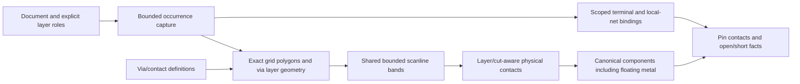

# ConductorCapture

## Purpose and Scope
Own bounded native rectilinear layer/cut contact facts. Parent:
[LayoutVerify](../DESIGN.md). RC models, process qualification and legacy UI
flyline/live-session representations remain separate responsibilities.

## Responsibilities and Boundaries
Capture every occurrence through HierarchyCapture, admit exact grid geometry,
retain all selected floating metal and each via layer/cut footprint, construct
physical contacts and report scoped declared-net and terminal facts. The caller
supplies conductive layer roles; display metadata does not define conductivity.
Pins label contacted components and never conduct or join disconnected islands.

## Related Designs
| Design | Relationship | Contract Used | Summary | Cautions |
|---|---|---|---|---|
| [LayoutVerify](../DESIGN.md) | parent | Native contact entry point | Electrical consumers use captured facts | Legacy aggregate-via analysis remains unqualified |
| [HierarchyCapture](../HierarchyCapture/DESIGN.md) | depends on | Occurrence paths and owned geometry | One traversal | Source IDs alone do not identify occurrences |
| [ViaGeometry](../../LayoutCore/ViaGeometry/DESIGN.md) | depends on | Definition-local transforms | Exact placed footprint | No bounding-box geometry substitution |
| [RectilinearDecomposition](../../../../swift-mask-data/Sources/MaskGeometry/RectilinearDecomposition/DESIGN.md) | depends on | Exact bounded bands | Concave and holed coverage | Existing exact-kernel capability is rectilinear |

## Architecture

## Contracts and Invariants
`captureConductors` returns owned integer geometry and occurrence-exact source
references. Selected conductor layers must be declared technology layers and
must not be cut layers. A cut layer has one unambiguous bottom/top adjacency
from the technology via/contact definitions; distinct cuts are never connected
by definition identity or by a declared net label. Vias retain individual cut
rectangles and every declared metal footprint. Incomplete explicit geometry,
unknown definitions and extra layers without topology fail. A definition with
no explicit geometry uses its declared cut size and top/bottom enclosure to
construct its three-layer template; this is defined geometry, not a fallback.

Source/world coordinates must be finite and representable on the document's
integer database grid within four floating-point ulps of multiplication error.
Int32 conversion is checked. Rectangles and rectilinear even-odd polygons use
the exact MaskGeometry kernel; empty conducting coverage, paths and non-Manhattan
geometry fail explicitly under the current exact-kernel capability.

Each band is one physical node. On the same layer, positive-area overlap or a
shared edge of positive length connects; a corner does not. Across cut/metal
layers, a declared adjacency and positive-area overlap are required. Two vias
can connect through their actual shared metal. No contact is invented from a
via's union bounding box. Overlapping bands remain separate source facts;
RC consumers own union coverage to avoid double-counting.

A net reference is source UUID plus occurrence index. Repeated local nets remain
independent unless a terminal binding explicitly maps them to a parent net.
Bindings resolve parent-first; conflicting parent assignments to one local net
fail. Unknown terminal names fail before contact generation. Physical components are independent of labels. Pins can label several
components without joining them. Every pin is retained, including pins with no
contact. Opens include disconnected declared-net components and bound pins with
no contact; shorts are components claimed by distinct resolved net references.
Component/contact/output order is deterministic for the same source value.

## State, Ownership, and Lifecycle
All state is synchronous and call-local. The returned hierarchy owns raw source
facts; polygons, bands, contacts and components are immutable Sendable values.
No shared mutable state or pointer escapes. A failure publishes no snapshot.

## Failure, Concurrency, and Constraints
Caller-owned limits bound hierarchy, geometry input/scan/output, technology
records (including explicit via geometry visited per occurrence), footprint nodes and candidate contact probes. A min-x sweep avoids
unrelated pairs; every visited candidate and pin probe is charged before work.
Dense overlap can exhaust the explicit budget rather than perform an unbounded
quadratic scan. Cancellation is checked at all admission/contact boundaries.
Defaults are host admission policy, not scale or platform qualification.

## Verification and Change Impact
[ConductorCaptureTests](../../../Tests/LayoutAutoGenTests/ConductorCaptureTests.swift)
owns disjoint cut arrays, via-via metal contact, floating metal, concave holes,
scoped hierarchy labels, pins, opens, shorts, exact grid rejection, limits and
cancellation. The dependency revision must include the verified bounded band API.
Native macOS evidence does not qualify WASM/Embedded or process/corner RC.
Legacy batch/live/device consumers must migrate their aggregate-via identity
before their electrical results can inherit this snapshot's topology guarantee.
