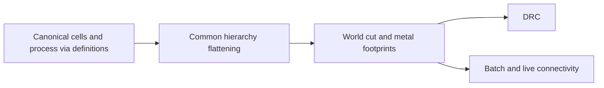

# LayoutVerify

## Purpose and Scope
DRC and shared physical contact calculations. Parent: [package](../../DESIGN.md).
Children: [HierarchyCapture](HierarchyCapture/DESIGN.md),
[ConductorCapture](ConductorCapture/DESIGN.md).

## Responsibilities and Boundaries
Own world-space via footprints, hierarchy flattening and contact predicates.
Use [ViaGeometry](../LayoutCore/ViaGeometry/DESIGN.md) for local placement.
Electrical RC models and tool qualification are outside this module.

## Related Designs
| Design | Relationship | Contract Used | Summary | Cautions |
|---|---|---|---|---|
| [ConductorCapture](ConductorCapture/DESIGN.md) | child | Bounded native layer/cut facts | Exact physical contacts and scoped terminal facts | Legacy aggregate-via analysis does not inherit this guarantee |
| [HierarchyCapture](HierarchyCapture/DESIGN.md) | child | Bounded occurrence geometry | Shared traversal | Electrical contacts remain separately owned |
| [Package](../../DESIGN.md) | parent | Physical verification facts | Package composition | Development bounds are not exact proof |
| [LayoutCore](../LayoutCore/DESIGN.md) | depends on | Canonical geometry and hierarchy | Read physical values | Preserve each occurrence's transform |
| [ViaGeometry](../LayoutCore/ViaGeometry/DESIGN.md) | depends on | Definition-local world transformation | Via cut and metal footprints | Preserve full source geometry for exact extraction |

## Architecture

## Contracts and Invariants
All via footprint helpers transform definition-local geometry through the via
value before computing world extents. Hierarchy flattening preserves definition
identity and source ID while retaining occurrence-specific local transforms.
Pin extents follow the same hierarchy. Bounding boxes remain a development
approximation for arbitrary angles, not exact source geometry.

## Verification and Change Impact
[HierarchicalViaGeometryTests](../../Tests/LayoutAutoGenTests/HierarchicalViaGeometryTests.swift)
executes transformed via/pin paths and batch/live contact equivalence.
Existing connectivity, DRC, layout IO and canonical serialization tests detect
regressions. Native RC composition must consume the bounded exact snapshot
contract before claiming extraction completion.
