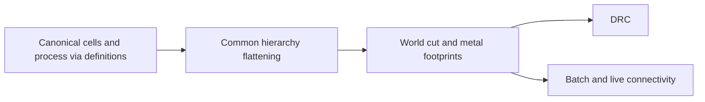

# LayoutVerify

## Purpose and Scope
DRC and shared physical contact calculations. Parent: [package](../../DESIGN.md).
Children: [HierarchyCapture](HierarchyCapture/DESIGN.md),
[ConductorCapture](ConductorCapture/DESIGN.md).

## Responsibilities and Boundaries
Own world-space via footprints, hierarchy flattening and contact predicates.
Production electrical consumers use ConductorCapture bands and contacts. Source
UUIDs identify editor highlights; independent bands identify electrical nodes.
Use [ViaGeometry](../LayoutCore/ViaGeometry/DESIGN.md) for local placement.
Electrical RC models and tool qualification are outside this module.

## Related Designs
| Design | Relationship | Contract Used | Summary | Cautions |
|---|---|---|---|---|
| [ConductorCapture](ConductorCapture/DESIGN.md) | child | Bounded native layer/cut facts | Exact physical contacts and scoped terminal facts | Legacy aggregate-via analysis does not inherit this guarantee |
| [HierarchyCapture](HierarchyCapture/DESIGN.md) | child | Bounded occurrence geometry | Shared traversal | Electrical contacts remain separately owned |
| [Package](../../DESIGN.md) | parent | Physical verification facts | Package composition | Development bounds are not exact proof |
| [LayoutCommands](../LayoutCommands/DESIGN.md) | used by | Scoped verdict and snapshot identity | CLI diagnosis serialization | Preserve occurrence/pin interpretation tables |
| [LayoutCore](../LayoutCore/DESIGN.md) | depends on | Canonical geometry and hierarchy | Read physical values | Preserve each occurrence's transform |
| [ViaGeometry](../LayoutCore/ViaGeometry/DESIGN.md) | depends on | Definition-local world transformation | Via cut and metal footprints | Preserve full source geometry for exact extraction |

## Architecture

## Contracts and Invariants
All via footprint helpers transform definition-local geometry through the via
value before computing world extents. Hierarchy flattening preserves definition
identity and source ID while retaining occurrence-specific local transforms.
Pin extents follow the same hierarchy. Bounding boxes remain a development
approximation for arbitrary angles, not exact source geometry.

### Production consumer migration
This table is the single migration matrix. Each consumer must preserve every
individual cut and metal band, actual path coverage, and scoped terminal labels.
Bounds prune candidates and describe display extents; they never establish a
contact or join pieces belonging to one source object.

| Consumer | Prior aggregate assumption | Required boundary | State |
|---|---|---|---|
| Batch connectivity | One shape/via source is one node | Native snapshot bands, contacts and pin labels | Migrated |
| Live connectivity | Source keys identify invalidation only | Exact edited bands, cached pin incidence, local partition and complete current native snapshot | Migrated; batch-identical generation and atomic failure proof |
| Device connectivity | One cut/via source is one node | Native bands for prepared channel/slab and conductor geometry | Migrated; native behavioral proof |
| Batch DRC opens | One via index joins all its cuts | Actual per-band components | Migrated; native behavioral proof |
| Incremental DRC opens | One via contact key is an electrical node | Source keys invalidate work; bands establish electrical connectivity | Migrated; native behavioral proof |
| Hierarchy terminal inference | One source via receives one inferred net | Occurrence-scoped component/pin labels without aggregate inference | Migrated; native behavioral proof |

The migration has three coherent boundaries: shared contact query and batch;
live atomic local replacement; device and DRC consumers. All six production
consumers now share native electrical facts. Unsupported native geometry and
ambiguous technology fail explicitly before successful electrical publication.

Each query between captures checks coordinate-scale compatibility and declared
cut/layer adjacency before contact. Unsupported exact geometry or incompatible
captures fail with typed errors. No alternate float geometry algorithm is used.
Live edits preserve the previous complete generation if preparation fails;
successful edits repartition only components touched by old or new contacts.
The [native composition boundary](ConductorCapture/DESIGN.md) owns current
source/pin/occurrence tables, polygon reindexing and full-profile scale admission.
Full snapshot allocation/copy and footprint-handle rebinding are linear in the
admitted fact count, with additional bounded canonical sorting; local
geometry decomposition, contact probes and repartition work are distinct costs.
The live session must not claim that every per-element operation is local.

Live sessions remain synchronous, single-owner values. Immutable snapshots may
be shared; this migration introduces no shared mutable state or Metal execution.

Connectivity verdicts retain the native `NetReference` (occurrence plus local
UUID) in nets, opens, shorts and flylines. UUID selectors in editing operations
explicitly select the root occurrence; projecting all child nets to UUID is not
an electrical identity conversion. Unconnected pins remain open facts even with
zero or one conductor island. Pin contacts label every touched component without
joining them. Batch lowering uses native contacts and component labels directly.
Public API changes require the LayoutEditor display/repair selectors and
HeadlessFinishNetPlanner to keep this root-selection boundary explicit.
The analysis owns its immutable source snapshot for the entire generation;
`unconnectedPinIndices` addresses `sourceSnapshot.pins`, whose `sourcePinIndex`
addresses the owned hierarchy's original pin and UUID. An index cannot be used
against another generation. The empty presentation value has no snapshot.
The development batch profile admits all registered non-cut layers explicitly;
process definitions supply cut roles. Unknown source layers fail rather than
disappear from an otherwise successful electrical analysis.

## Verification and Change Impact
[ProductionConnectivityCaptureTests](../../Tests/LayoutAutoGenTests/ProductionConnectivityCaptureTests.swift)
owns individual-cut partitioning, scoped labels, isolated pins, strict snapshot
contact compatibility and all production consumer admission.
[LayoutConnectivityDiagnosisTests](../../Tests/LayoutCommandsTests/LayoutConnectivityDiagnosisTests.swift)
executes the CLI and decodes the scoped report, including its occurrence and pin
interpretation table. [ProductionConsumerScopedTests](../../Tests/LayoutAutoGenTests/ProductionConsumerScopedTests.swift)
proves contact alternatives, pin-lattice provenance, independent repeated devices,
serialized isolated-pin evidence, scoped minimum cuts and native incremental
failure atomicity. Existing LiveLVSSession tests execute generated MOS channel
isolation and contact disconnection through actual extraction.
[HierarchicalViaGeometryTests](../../Tests/LayoutAutoGenTests/HierarchicalViaGeometryTests.swift)
executes transformed via/pin paths and batch/live contact equivalence.
Existing connectivity, DRC, layout IO and canonical serialization tests detect
regressions. Native RC composition must consume the bounded exact snapshot
contract before claiming extraction completion.

## Remaining Production Consumer Migration Contract
Device connectivity uses the native owner's prepared source geometry boundary,
retaining original occurrence/scoped net facts for channel-separated slabs.
Device root ports are selected by the captured root pin range, and native pin
incidence selects terminal components; a pin UUID never identifies an occurrence.
Root comparison names retain their external interface meaning; independent
child nets and labels include their occurrence path in comparison names.

Batch DRC and incremental DRC electrical violations consume native component,
open and short facts. Raw UUID fields remain highlighting information. Electrical
selection (including minimum-cut source matching) uses NetReference resolved
from the source index and occurrence. Minimum-cut features must intersect the
actual bottom/top Region intersection with positive area; its display bounds
never count a feature lying in an overlap hole. Incremental opens use the verified live
consumer's actual piece graph and local replacement, replacing aggregate-via
contact caches. Geometry checks retain their existing independent ownership.

Standalone DRC results retain the existing HierarchySnapshot value, and
violations retain scoped net references and source pin indices addressing that
same generation. Snapshot encoding includes occurrence paths/bindings and owned
pin sources, so numeric occurrence or pin indices are never presented alone as
durable identity. Legacy flattening provides raw world/source geometry and
performs no source-wide inferred net annotation. Native bindings/labels are the
sole electrical authority. Failure before native preparation succeeds must
preserve the previous live generation. Split comparison names use the physical
island namespace, so input pin/net names cannot collide with generated split
identities.

Existing scale benchmarks that assert 50ms debug edits or implicit admission of
~170k routed elements are separate pending performance qualification. Full native
generation materialization is O(N); current default decomposition/contact limits
remain unchanged. Functional proof does not claim those latency/workload caps,
and their assertions are retained rather than silently raised.

Behavioral proof includes sample-process contact alternatives, channel
source/drain isolation, disconnected individual cuts, ambiguous via rejection,
repeated local UUIDs and pin names, serialized isolated-pin failures, and batch
versus incremental electrical equality. Lower geometry/role changes require
rechecking the model-bound metal-only PEX assumptions and actual caller closure.

## Explicit Device Electrical Context
Raw geometric capture remains the all-registered non-cut physical profile.
MOS electrical consumers explicitly select the DeviceExtractor-owned context:
configured active/poly recognition, channel-separated diffusion geometry and
configured implant exclusion. The native snapshot records that context and the
selected layers. No generic capture silently changes profile. The same bounded
preparation is used by Device extraction, context batch/live analysis and DRC.
Live comparison of owned prepared overlays expands invalidation to active
sources affected by edited gates; decomposition/contact/repartition remains
local while hierarchy/source scans and full materialization are bounded O(N).
Channel recognition consumes the separately admitted pair budget below.

Annotation selects components with native band point coverage and binds the
exact source-pin incidence. A shape/via spanning multiple electrical components
cannot receive one inferred net wholesale. Root pins receive root net IDs;
child pins receive scoped terminal bindings along their recorded instance path.
Missing/ambiguous path mappings fail explicitly. Reports retain context and
hierarchy so geometric and MOS electrical verdicts remain distinguishable.
Headless routing, editor verification and inspection use the explicit context;
unsupported preparation yields a structured failed result, never empty success.

Open violation identity is the resolved scoped net, not its changing highlight
member set. A repair or route that changes a pre-existing open's membership
does not manufacture a new open identity. Physical violations and shorts retain
participant identities. Repair rejects scoped child geometry and failed DRC
captures before offering or applying a candidate; minimum-cut mutation requires
one explicitly root-owned NetReference. Interactive route snapping uses native
component footprints and actual scoped pin bindings under the same context.

Device preparation scans source geometry once to collect ACTIVE and rectangular
POLY candidates, then probes only ACTIVE × POLY pairs. Each pair consumes one
caller `maximumContactProbes` unit before intersection; no repeated whole-source
scan hides behind that count. Channel sorting is bounded by admitted pairs, and
prepared slab emission consumes `maximumFootprints` before allocation. Full
hierarchy/source generation materialization remains separately bounded O(N);
preparation is O(N + admitted pairs + channel sorting), not claimed O(N). Live
updates compare old/current root source overlays and recapture changed ACTIVE
slabs as well as directly edited gate geometry before atomic installation.

Prepared Device slab footprints retain the recognized low/high channel and
active boundaries as four explicit polygon endpoints. Derived high-minus-low
span subtraction is display/recognition metadata, not a new source coordinate
for native grid admission. This preserves repeated translated occurrences.
