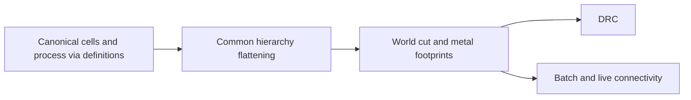

# LayoutVerify

## Purpose and Scope
DRC and shared physical contact calculations. Parent: [package](../../DESIGN.md).
Children: [HierarchyCapture](HierarchyCapture/DESIGN.md),
[ConductorCapture](ConductorCapture/DESIGN.md).

## Responsibilities and Boundaries
Own world-space via footprints, hierarchy flattening and contact predicates.
Production electrical consumers use ConductorCapture bands and contacts. Source
UUIDs identify editor highlights; independent bands identify electrical nodes.
Use [ViaGeometry](../LayoutCore/ViaGeometry/DESIGN.md) for local placement.
Electrical RC models and tool qualification are outside this module.

## Related Designs
| Design | Relationship | Contract Used | Summary | Cautions |
|---|---|---|---|---|
| [ConductorCapture](ConductorCapture/DESIGN.md) | child | Bounded native layer/cut facts | Exact physical contacts and scoped terminal facts | Legacy aggregate-via analysis does not inherit this guarantee |
| [HierarchyCapture](HierarchyCapture/DESIGN.md) | child | Bounded occurrence geometry | Shared traversal | Electrical contacts remain separately owned |
| [Package](../../DESIGN.md) | parent | Physical verification facts | Package composition | Development bounds are not exact proof |
| [LayoutCommands](../LayoutCommands/DESIGN.md) | used by | Scoped verdict and snapshot identity | CLI diagnosis serialization | Preserve occurrence/pin interpretation tables |
| [LayoutCore](../LayoutCore/DESIGN.md) | depends on | Canonical geometry and hierarchy | Read physical values | Preserve each occurrence's transform |
| [ViaGeometry](../LayoutCore/ViaGeometry/DESIGN.md) | depends on | Definition-local world transformation | Via cut and metal footprints | Preserve full source geometry for exact extraction |

## Architecture

## Contracts and Invariants
All via footprint helpers transform definition-local geometry through the via
value before computing world extents. Hierarchy flattening preserves definition
identity and source ID while retaining occurrence-specific local transforms.
Pin extents follow the same hierarchy. Bounding boxes remain a development
approximation for arbitrary angles, not exact source geometry.

### Production consumer migration
This table is the single migration matrix. Each consumer must preserve every
individual cut and metal band, actual path coverage, and scoped terminal labels.
Bounds prune candidates and describe display extents; they never establish a
contact or join pieces belonging to one source object.

| Consumer | Prior aggregate assumption | Required boundary | State |
|---|---|---|---|
| Batch connectivity | One shape/via source is one node | Native snapshot bands, contacts and pin labels | Migrated |
| Live connectivity | Source keys identify invalidation only | Exact edited bands, cached pin incidence, local partition and complete current native snapshot | Migrated; batch-identical generation and atomic failure proof |
| Device connectivity | One cut/via source is one node | Native bands for prepared channel/slab and conductor geometry | Explicitly unavailable pending migration |
| Batch DRC opens | One via index joins all its cuts | Actual per-band components | Explicitly unavailable pending migration |
| Incremental DRC opens | One via contact key is an electrical node | Source keys invalidate work; bands establish electrical connectivity | Explicitly unavailable pending migration |
| Hierarchy terminal inference | One source via receives one inferred net | Occurrence-scoped component/pin labels without aggregate inference | Explicitly unavailable pending migration |

The migration has three coherent boundaries: shared contact query and batch;
live atomic local replacement; device and DRC consumers. Callable consumers
that have not crossed their boundary carry an incomplete-implementation marker
and fail explicitly rather than publish aggregate electrical results.
Hierarchy admission errors retain priority over the temporary migration failure.

Each query between captures checks coordinate-scale compatibility and declared
cut/layer adjacency before contact. Unsupported exact geometry or incompatible
captures fail with typed errors. No alternate float geometry algorithm is used.
Live edits preserve the previous complete generation if preparation fails;
successful edits repartition only components touched by old or new contacts.
The [native composition boundary](ConductorCapture/DESIGN.md) owns current
source/pin/occurrence tables, polygon reindexing and full-profile scale admission.
Full snapshot allocation/copy and footprint-handle rebinding are linear in the
admitted fact count, with additional bounded canonical sorting; local
geometry decomposition, contact probes and repartition work are distinct costs.
The live session must not claim that every per-element operation is local.

Live sessions remain synchronous, single-owner values. Immutable snapshots may
be shared; this migration introduces no shared mutable state or Metal execution.

Connectivity verdicts retain the native `NetReference` (occurrence plus local
UUID) in nets, opens, shorts and flylines. UUID selectors in editing operations
explicitly select the root occurrence; projecting all child nets to UUID is not
an electrical identity conversion. Unconnected pins remain open facts even with
zero or one conductor island. Pin contacts label every touched component without
joining them. Batch lowering uses native contacts and component labels directly.
Public API changes require the LayoutEditor display/repair selectors and
HeadlessFinishNetPlanner to keep this root-selection boundary explicit.
The analysis owns its immutable source snapshot for the entire generation;
`unconnectedPinIndices` addresses `sourceSnapshot.pins`, whose `sourcePinIndex`
addresses the owned hierarchy's original pin and UUID. An index cannot be used
against another generation. The empty presentation value has no snapshot.
The development batch profile admits all registered non-cut layers explicitly;
process definitions supply cut roles. Unknown source layers fail rather than
disappear from an otherwise successful electrical analysis.

## Verification and Change Impact
[ProductionConnectivityCaptureTests](../../Tests/LayoutAutoGenTests/ProductionConnectivityCaptureTests.swift)
owns individual-cut partitioning, scoped labels, isolated pins, strict snapshot
contact compatibility and explicit failures for consumers pending migration.
[LayoutConnectivityDiagnosisTests](../../Tests/LayoutCommandsTests/LayoutConnectivityDiagnosisTests.swift)
executes the CLI and decodes the scoped report, including its occurrence and pin
interpretation table. The legacy terminal-resolution and development-DRC success
tests remain owned by the subsequent consumer migration boundary; the shared
contact/batch boundary does not claim their success while those paths are gated.
[HierarchicalViaGeometryTests](../../Tests/LayoutAutoGenTests/HierarchicalViaGeometryTests.swift)
executes transformed via/pin paths and batch/live contact equivalence.
Existing connectivity, DRC, layout IO and canonical serialization tests detect
regressions. Native RC composition must consume the bounded exact snapshot
contract before claiming extraction completion.
