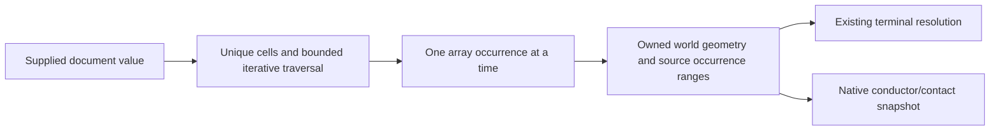

# HierarchyCapture

## Purpose and Scope
Own bounded, occurrence-exact world geometry capture. Parent:
[LayoutVerify](../DESIGN.md). Contact graph construction and electrical models
remain separate responsibilities.

## Responsibilities and Boundaries
Capture a supplied immutable layout value; preserve source identifiers, every
instance/array path, world shape/via/pin geometry and parent terminal mappings.
Never resolve missing children, cycles or invalid geometry as empty success.
Legacy DRC/connectivity consumers use this same traversal and resolve terminal
labels afterwards. Capture itself does not claim electrical connectivity.

## Related Designs
| Design | Relationship | Contract Used | Summary | Cautions |
|---|---|---|---|---|
| [LayoutVerify](../DESIGN.md) | parent | Shared flattening | One hierarchy traversal | Contact work has separate limits |
| [LayoutCore](../../LayoutCore/DESIGN.md) | depends on | Value geometry and transforms | Capture source values | Scale path width with geometry |
| [ViaGeometry](../../LayoutCore/ViaGeometry/DESIGN.md) | depends on | Complete via pose | Retain definition-local transforms | Definition topology is not inferred here |

## Architecture

## Contracts and Invariants
Each occurrence retains its source cell ID, parent occurrence index, ordered
instance ID/row/column path, terminal mapping and disjoint output ranges.
Repeated cell IDs remain source identities; occurrence paths disambiguate them.
The root path is empty. Traversal is source-order depth first, preserving the
existing top-element prefixes and flatten ordering. Pins retain both the
legacy world envelope and full transformed rectangle geometry.

Limits belong to the caller and are validated before traversal. The default
host profile permits one million occurrences and objects, eight million
geometry points/transform entries and depth 64. These are admission ceilings,
not performance qualification; callers may supply explicit limits. Raising a
limit requires rerunning the relevant boundary/resource tests and independently
qualifying the new workload. Input cell lookup is occurrence-budget bounded.
Arrays expand lazily; positive rows/columns and checked multiplication are
required before their first child is admitted. Every emitted object and geometry
point/transform entry is charged before allocation. All local/world coordinates,
widths, extents and transform parameters must be finite; nonpositive rectangle
sizes, path widths and magnifications fail. Finite degenerate polygons are
retained as source facts, including their contribution bounds; capture does not
promote them to a conducting surface. Exact consumers own geometric capability
admission. Missing cells, duplicate local IDs, cycles, budget exhaustion
and cancellation throw typed errors. No partial capture is returned.

## State, Ownership, and Lifecycle
All mutable traversal state is synchronous and local to one call. The supplied
Sendable value snapshot owns source storage through Swift value semantics;
returned arrays own captured values. No pointer or shared mutable state escapes.
There is no target-specific storage/isolation branch. This host package's native
evidence is not WASM/Embedded qualification.

## Failure, Concurrency, and Constraints
Cancellation is checked at input/occurrence/object/point boundaries and after
capture. Stack depth and heap growth follow explicit limits. Capture performs no
I/O, contact graph, spatial-index construction or flyline calculation. Geometry
outside later exact-kernel capabilities is retained faithfully here and must be
admitted or rejected by that consumer.

## Verification and Change Impact
[HierarchyCaptureTests](../../../Tests/LayoutAutoGenTests/HierarchyCaptureTests.swift)
checks repeated/nested identity, source/world geometry, pin rectangles, finite
arithmetic, malformed repetitions, typed limits, missing children, cycles and
cancellation. Existing batch/live/DRC/editor/device tests verify legacy terminal
resolution and failure propagation over the shared traversal. Changing order or
ranges requires rechecking their top/child split and native snapshot consumers.

Capture is directly developer-operable through
`LayoutConnectivityExtractor().captureHierarchy(document:limits:isCancelled:)`.
Run `swift test --filter HierarchyCaptureTests` under the workspace bounded
runner. DRC checked failures preserve original structured geometry diagnostics;
the nonthrowing DRC entry point returns the same diagnostics, never a clean
result after a capture failure.
