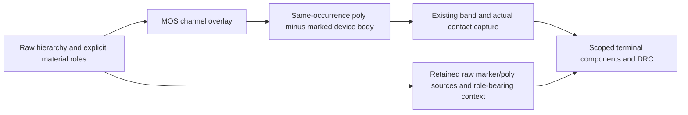

# Passive Device Preparation

## Purpose and Scope
Own the explicit poly-resistor body boundary used by Device-owned native
connectivity. Parent: [LayoutVerify](../DESIGN.md). No children. This contract
supports the existing generated rectangular poly resistor, not arbitrary passive
recognition or an electrical resistance model.

## Responsibilities and Boundaries
The caller supplies distinct registered poly conductor and resistor body-marker
layer identities. No cell name, label, color or net assignment identifies a
resistor. The marker denotes finite-resistance device material, which is excluded
from ideal-wire connectivity while its original physical geometry remains intact.
MOS channel preparation precedes this preparation; both produce one overlay for
the existing native owner, not another connectivity graph.

## Related Designs
| Design | Relationship | Contract Used | Summary | Cautions |
|---|---|---|---|---|
| [LayoutVerify](../DESIGN.md) | parent | Device electrical context | Explicit composition | Raw geometric capture stays geometric |
| [ConductorCapture](../ConductorCapture/DESIGN.md) | depends on | Owned lattice and source occurrence | Actual terminal contacts | UUID alone cannot select an occurrence |
| [MaskGeometry](../../../../swift-mask-data/Sources/MaskGeometry/RectilinearDecomposition/DESIGN.md) | depends on | Integer geometry owner | Exact Region difference | Floating bounding boxes never create contacts |

## Architecture

## Contracts and Invariants
Admit original source rectangle spans or original polygon vertices on the native
owner's selected coordinate lattice. Supported poly and marker geometry consists
of exact axis-aligned rectangles, including four-corner hierarchy polygons.
A marker must intersect exactly one poly source in its own occurrence and fully
cross that source on one axis while leaving positive terminal coverage on both
ends of the other axis. Multiple markers on one poly, unmatched or ambiguous
markers, unsupported geometry, unknown or coincident material roles and cut-role
collisions fail explicitly. A contact partially crossing the body edge remains
valid when actual positive-area terminal material survives; no contact is moved.
Contacts wholly over excluded body receive no invented poly contact.

The shared integer Region difference produces the retained two terminal pieces.
Every piece keeps the original poly source index, UUID and occurrence. The native
contact and pin predicates determine terminal incidence, opens and real metal
bypasses. Removing the marker restores a wire short. Removing contact geometry
exposes an open; adding a real wire bypass exposes a short. Raw document/hierarchy
geometry is unchanged. Snapshot context retains actual layer roles and the owned
hierarchy retains original marker geometry; the prepared source overlay retains
what body was excluded. This is device topology, not numerical R qualification.

## Failure, Concurrency, and Constraints
All preparation is call-local and immutable on publication. MOS and passive
candidate pairs share the caller contact-probe preparation ceiling; every pair is
charged before intersection. Hierarchy input admission bounds collection, and
prepared polygons consume existing footprint/decomposition ceilings before
publication. The rectangular one-marker difference has constant kernel input.
Cancellation, off-grid/range failures, role ambiguity and unsupported bodies
publish no snapshot; live sessions preserve the prior generation.
MOS and passive preparation forward the invocation's same cancellation predicate
to their existing checkpoints, coordinate-scale admission and final native
capture. The default remains Task cancellation for callers that omit it.

## Verification and Change Impact
[PassiveDeviceConnectivityTests](../../../Tests/LayoutAutoGenTests/PassiveDeviceConnectivityTests.swift)
proves generated resistors, raw versus prepared topology, repeated source UUIDs,
marker provenance/codec, actual contact removal and real bypass shorts, invalid
body admission, budgets/cancellation and batch/live equality. Studio's unchanged
DesignFlowServiceTests retain the original three pre-PEX success assertions and
exercise this explicit profile across synthesis, repair and verification.
